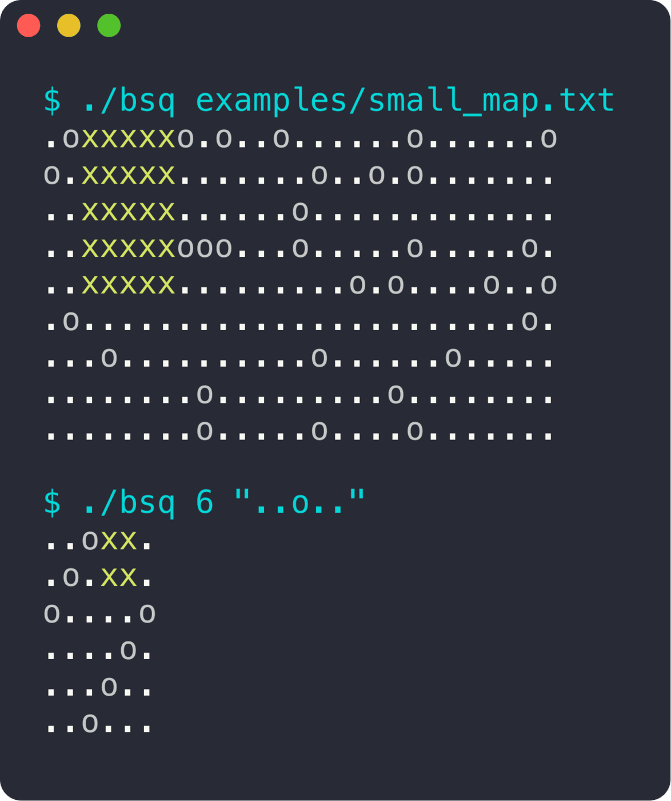

<div align="center">

# BSQ

**Trouver le plus grand carré libre sur une carte, très vite.**

 

<sub>Projet solo · 2022</sub>

</div>

<br/>

<p align="center"></p>

## En deux mots

On donne une carte remplie d'obstacles (`o`), et le programme trouve le plus grand carré vide, qu'il dessine avec des `x`. Le projet est évalué sur sa vitesse : une carte de 1000×1000 est résolue en moins d'un dixième de seconde.

## Ce que ça fait

- Algorithme en **programmation dynamique**, en un seul passage sur la carte
- Mode génération : `./bsq 6 "..o.."` crée une carte 6×6 à partir d'un motif et la résout
- Cartes d'exemple dans [`examples/`](examples), dont une de 1000×1000

## Sous le capot

Pour chaque case vide, la taille du plus grand carré dont elle est le coin en bas à droite vaut `1 + min(haut, gauche, haut-gauche)`. On garde le maximum en un seul parcours, puis on remplit le carré avec des `x`.

## Lancer le projet

```bash
make
./bsq examples/small_map.txt
./bsq examples/big_map_1000x1000.txt
./bsq 6 "..o.."
```
